# ICS 3202: Practical Exercise 3

## Designing a Searching Agent

### Group members

| Student number | Name |
|---|---|
| 189984 | Muriuki Alvin Murithi |
| 192576 | Sebudde Jeremy Mwesigwa |
| 189588 | Mutungi Travis Njenga |

**Repository:** [PS-Agents](https://github.com/cypher-30/PS-Agents)

## 1. PEAS description of the self-driving trailer agent

The trailer agent drives from Nairobi to Kisumu. Its main job is to get the load there safely and choose a route.

| PEAS element | Description |
|---|---|
| **Performance measure** | Deliver the load safely and without damage, follow traffic laws, use fuel well, and keep the route short. |
| **Environment** | Kenyan roads, towns, traffic, road signs, roadworks, weather, terrain, the trailer and its load, and other road users. |
| **Actuators** | Steering, accelerator, brakes, gears, indicators, lights, horn, and trailer controls. |
| **Sensors** | GPS and maps, cameras, radar, lidar, proximity sensors, wheel sensors, and vehicle and trailer monitors. |

## 2. Agent environment classifications

The trailer operates in the following kind of environment:

| Dimension | Classification | Reason |
|---|---|---|
| Observability | **Partially observable** | The sensors cannot detect every hazard or tell what another driver will do. |
| Determinism | **Stochastic** | Traffic, weather, and other road users can change what happens next. |
| Task structure | **Sequential** | Each driving decision affects the next part of the trip. |
| Change over time | **Dynamic** | Traffic and road conditions can change while the trailer is moving. |
| Number of agents | **Multi-agent** | Other drivers, pedestrians, and cyclists share the road. |

## 3. Road-network graph and search problem

### Abstraction

We treated each town as one state and each main road between two towns as one link. The towns come from the four regions on the class map: Nairobi, Central Highlands, Rift Valley and Lake Victoria Basin. Everything smaller than a town is left out: junctions, local roads, lanes, and the steering and braking the trailer does between towns. None of that changes which town the trailer should go to next, so the search does not need it.

We also kept the longer Thika and Nyeri branch on purpose. A route can look slower and still turn out to be the cheaper one, so the search has to compare it and drop it, not skip it.

Every link is a two-way road, so each one is two arcs (one each way) with the same distance.

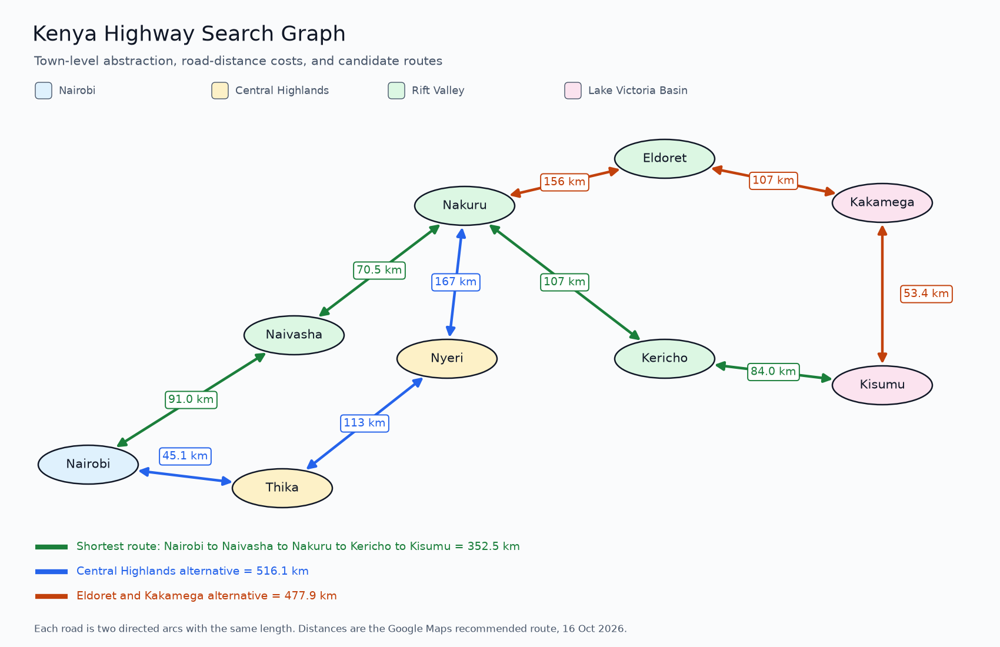

### Search problem

The goal is to get the trailer from Nairobi to Kisumu. Following the class steps, the problem is set up like this:

| Part | Description |
|---|---|
| Initial state | Nairobi |
| State space and actions | The towns in the graph are the states. An action is driving along a road link to a connected town. |
| Goal test | Is the trailer in Kisumu? |
| Path cost | The sum of the road distances (km) along the route |

For this model, the listed roads are assumed open and usable in both directions. Traffic and travel time are not included.

### Google Maps road-distance lookups

For each pair of towns we searched the driving directions on Google Maps on 16 October 2026 and used the distance of the route it recommends first (the fastest one). Maps shows whole kilometres once a route passes 100 km, so those figures have no decimal. Each link opens the same search, and the screenshots below show what Maps gave us.

| Road between towns | Distance | Google Maps |
|---|---:|---|
| Nairobi and Naivasha | 91.0 km | [Nairobi to Naivasha](https://www.google.com/maps/dir/?api=1&origin=Nairobi%2C+Kenya&destination=Naivasha%2C+Kenya&travelmode=driving) |
| Naivasha and Nakuru | 70.5 km | [Naivasha to Nakuru](https://www.google.com/maps/dir/?api=1&origin=Naivasha%2C+Kenya&destination=Nakuru%2C+Kenya&travelmode=driving) |
| Nairobi and Thika | 45.1 km | [Nairobi to Thika](https://www.google.com/maps/dir/?api=1&origin=Nairobi%2C+Kenya&destination=Thika%2C+Kenya&travelmode=driving) |
| Thika and Nyeri | 113 km | [Thika to Nyeri](https://www.google.com/maps/dir/?api=1&origin=Thika%2C+Kenya&destination=Nyeri%2C+Kenya&travelmode=driving) |
| Nyeri and Nakuru | 167 km | [Nyeri to Nakuru](https://www.google.com/maps/dir/?api=1&origin=Nyeri%2C+Kenya&destination=Nakuru%2C+Kenya&travelmode=driving) |
| Nakuru and Kericho | 107 km | [Nakuru to Kericho](https://www.google.com/maps/dir/?api=1&origin=Nakuru%2C+Kenya&destination=Kericho%2C+Kenya&travelmode=driving) |
| Kericho and Kisumu | 84.0 km | [Kericho to Kisumu](https://www.google.com/maps/dir/?api=1&origin=Kericho%2C+Kenya&destination=Kisumu%2C+Kenya&travelmode=driving) |
| Nakuru and Eldoret | 156 km | [Nakuru to Eldoret](https://www.google.com/maps/dir/?api=1&origin=Nakuru%2C+Kenya&destination=Eldoret%2C+Kenya&travelmode=driving) |
| Eldoret and Kakamega | 107 km | [Eldoret to Kakamega](https://www.google.com/maps/dir/?api=1&origin=Eldoret%2C+Kenya&destination=Kakamega%2C+Kenya&travelmode=driving) |
| Kakamega and Kisumu | 53.4 km | [Kakamega to Kisumu](https://www.google.com/maps/dir/?api=1&origin=Kakamega%2C+Kenya&destination=Kisumu%2C+Kenya&travelmode=driving) |

These distances are for the graph used here. Google Maps can change its routes, and for some pairs it also lists a slightly shorter or longer alternative. We kept to the recommended route every time so the costs are consistent.

**Google Maps screenshots**

| | |
|---|---|
| 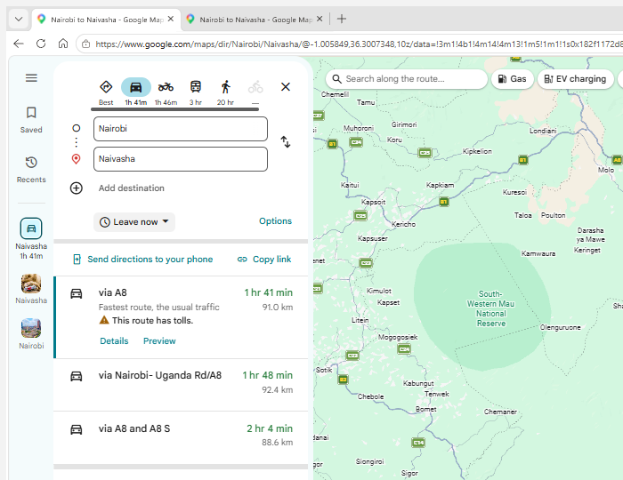 | 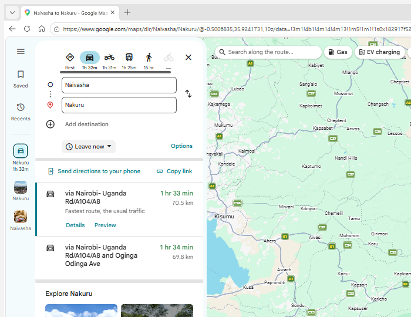 |
| 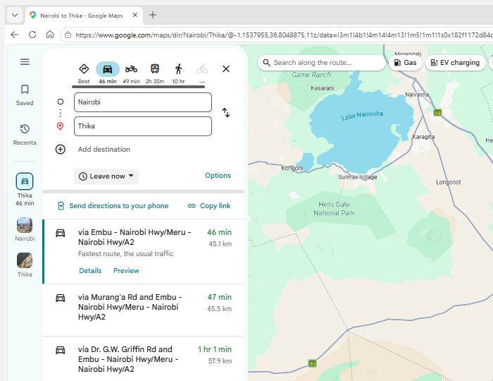 | 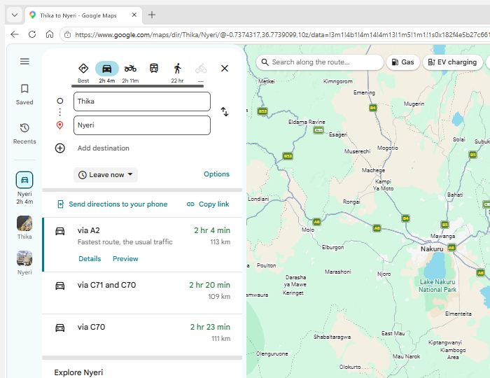 |
| 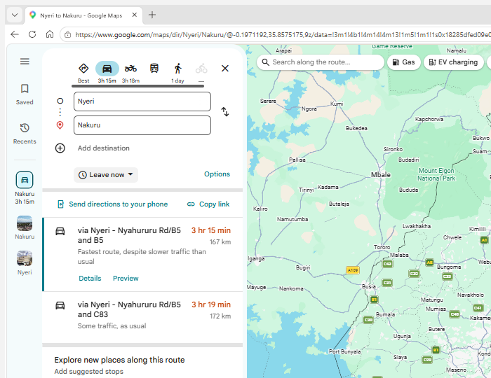 | 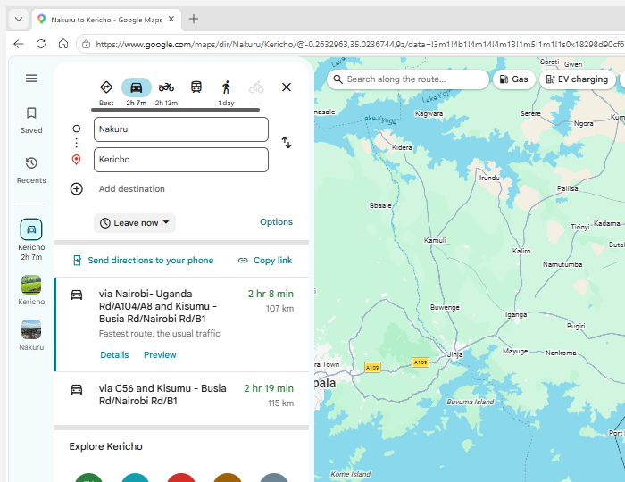 |
| 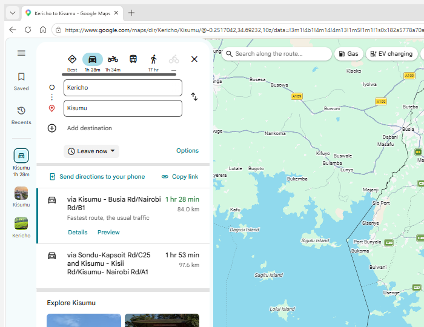 | 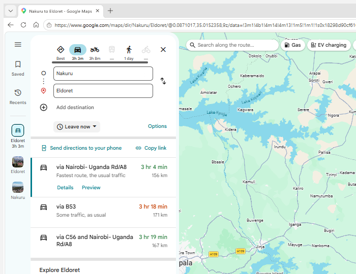 |
| 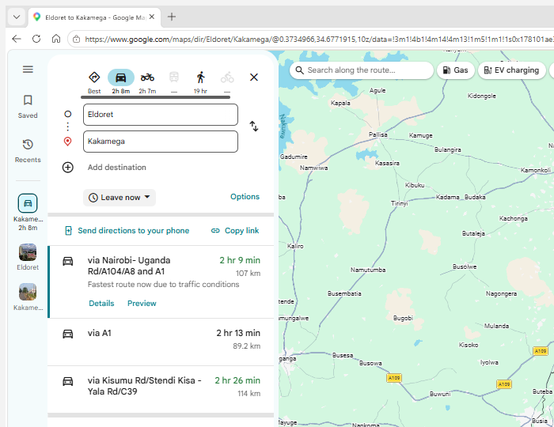 | 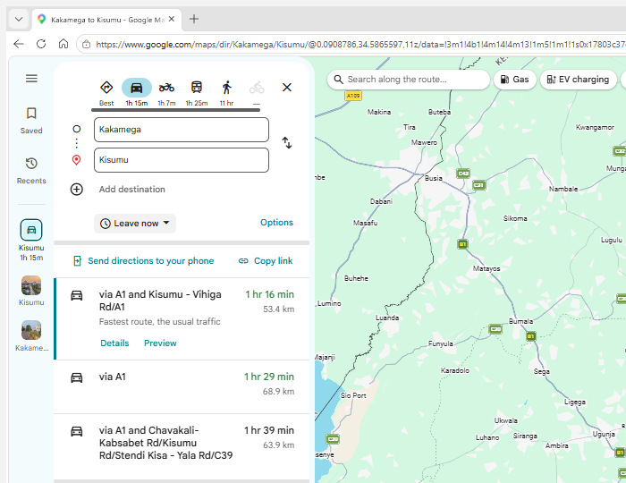 |

### Search tree

We used uniform-cost search because the cost is distance. It always expands the town with the lowest total distance so far. In the tree, the number beside each town shows its expansion order. UCS first reaches Nakuru through Naivasha at 161.5 km. The longer path through Nyeri (325.1 km) is discarded.

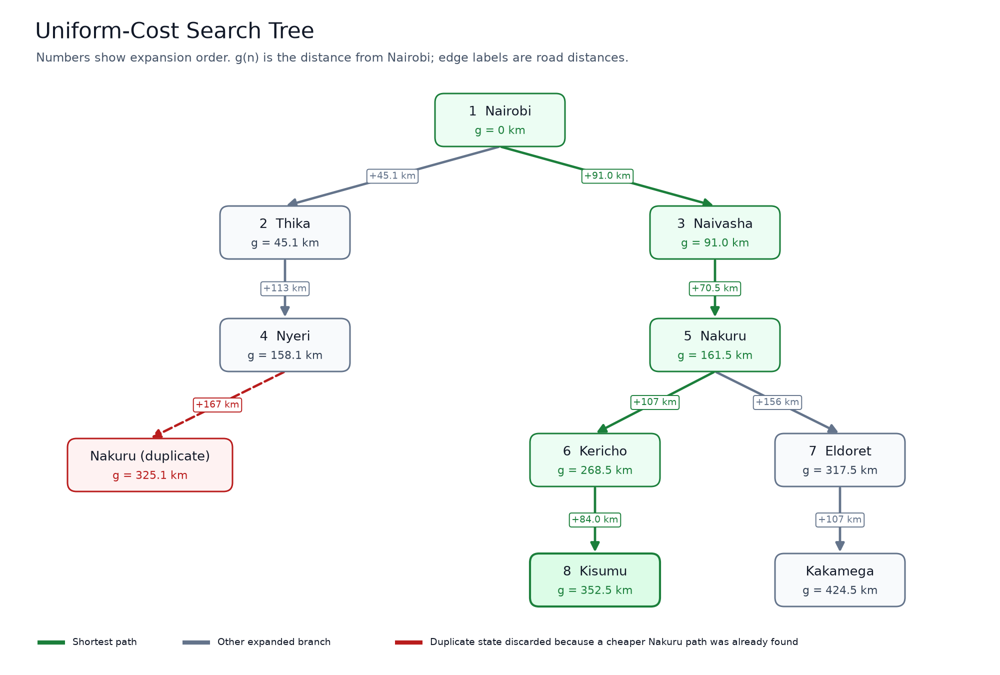

The search order and the useful updates are:

| Step | Town expanded | Result |
|---:|---|---|
| 1 | Nairobi | Add Thika at 45.1 km and Naivasha at 91.0 km. |
| 2 | Thika | Add Nyeri at 158.1 km. |
| 3 | Naivasha | Add Nakuru at 161.5 km. |
| 4 | Nyeri | The route to Nakuru is 325.1 km, so keep the cheaper 161.5 km route. |
| 5 | Nakuru | Add Kericho at 268.5 km and Eldoret at 317.5 km. |
| 6 | Kericho | Add Kisumu at 352.5 km. |
| 7 | Eldoret | Add Kakamega at 424.5 km. |
| 8 | Kisumu | The goal is removed from the frontier at 352.5 km, so the search stops. |

## 4. Minimum-distance route from Nairobi to Kisumu

For each route, we added up the road distances between towns:

| Route | Distance added | Total |
|---|---|---:|
| Nairobi to Naivasha to Nakuru to Kericho to Kisumu | 91.0 + 70.5 + 107 + 84.0 | **352.5 km** |
| Nairobi to Naivasha to Nakuru to Eldoret to Kakamega to Kisumu | 91.0 + 70.5 + 156 + 107 + 53.4 | 477.9 km |
| Nairobi to Thika to Nyeri to Nakuru to Kericho to Kisumu | 45.1 + 113 + 167 + 107 + 84.0 | 516.1 km |
| Nairobi to Thika to Nyeri to Nakuru to Eldoret to Kakamega to Kisumu | 45.1 + 113 + 167 + 156 + 107 + 53.4 | 641.5 km |

The shortest route in this graph is **Nairobi to Naivasha to Nakuru to Kericho to Kisumu**, at **352.5 km**. Uniform-cost search finds it before the other routes reach Kisumu. This result applies to the roads included in this graph, not every possible road in Kenya.

## 5. Group-work evidence

### GitHub links

Alvin's repository is the original. Jeremy and Travis each forked it.

| Group member | Repository | GitHub link |
|---|---|---|
| Muriuki Alvin Murithi | Original | [cypher-30/PS-Agents](https://github.com/cypher-30/PS-Agents) |
| Sebudde Jeremy Mwesigwa | Fork | [makemissionllc/PS-Agents](https://github.com/makemissionllc/PS-Agents) |
| Mutungi Travis Njenga | Fork | [Trav1s5/PS-Agents](https://github.com/Trav1s5/PS-Agents) |

The forks page of the original repository lists both forks:

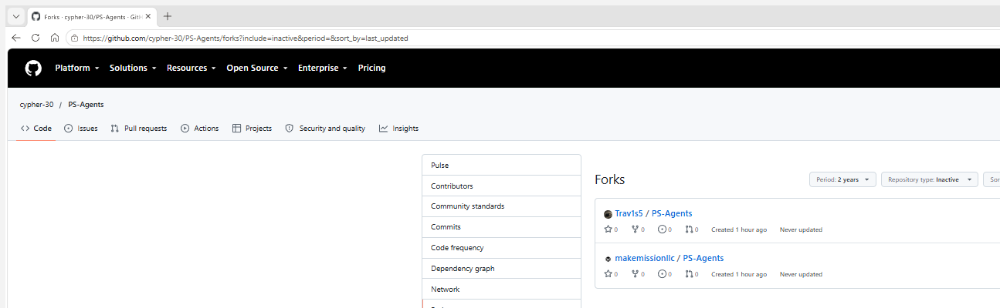

### Team photo

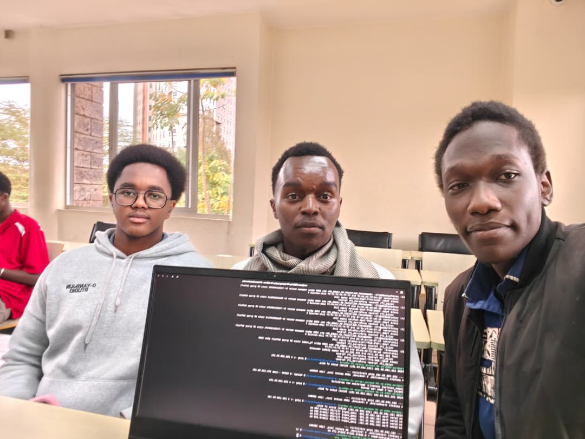

### Meeting minutes

#### Meeting 1

| Item | Details |
|---|---|
| Date | Friday, 9 October 2026 |
| Time | 12:40 pm to 2:20 pm |
| Venue | Lib 1 |
| Members | Muriuki Alvin Murithi, Sebudde Jeremy Mwesigwa, Mutungi Travis Njenga |
| Agenda | Review Practical Exercise 3 and agree on the agent description, map abstraction, and route-search approach. |

**Discussion**

- Agreed to describe the trailer using PEAS and the five environment dimensions.
- Chose towns in the four regions for the map and agreed to use road distance as the path cost.
- Agreed to compare routes from Nairobi to Kisumu.

**Next steps**

- Jeremy: write the PEAS description and environment classifications.
- Travis: look up the town-to-town distances on Google Maps and add up the route totals.
- Alvin: draw the graph and search tree and start the design.md layout.
- Everyone: fork the PS-Agents repository before the next meeting.

#### Meeting 2

| Item | Details |
|---|---|
| Date | Tuesday, 13 October 2026 |
| Time | 12:15 pm to 1:00 pm |
| Venue | STC 2nd Floor |
| Members | Muriuki Alvin Murithi, Sebudde Jeremy Mwesigwa, Mutungi Travis Njenga |
| Agenda | Review the route calculations, check the search result, and organize the final Markdown document and group evidence. |

**Discussion**

- Compared the distances for the routes through Naivasha, the Central Highlands, and Eldoret.
- Agreed to use uniform-cost search and chose the route through Naivasha, Nakuru, and Kericho as the shortest.
- Reviewed the document and group photo.
- Checked that all three forks exist and that the images show up in design.md.

**Next steps**

- Alvin: upload the final design.md and images to the PS-Agents repository.
- Alvin: submit the repository link on e-learning for the group.
- Jeremy and Travis: confirm the fork links in section 5 are theirs.
